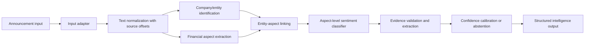

# Financial Intelligence Pipeline Design

**Status:** Architecture proposal for review. No processing or inference code is implemented by this document. All examples below are synthetic and illustrative; their labels are example annotations, not model predictions or measured results.

## 1. Current project state

The current `processing/` and `intelligence/` modules define interfaces but do not yet implement their behavior:

| Existing module | Current role/status |
|---|---|
| `processing/cleaner.py` | `clean_text()` is an unimplemented placeholder. |
| `processing/deduplicator.py` | `is_duplicate()` is an unimplemented placeholder. It is document deduplication, not semantic analysis. |
| `intelligence/entity_extractor.py` | `extract_companies()` is an unimplemented placeholder; it does not resolve names to `Company.identifier`. |
| `intelligence/aspect_extractor.py` | `extract_aspects()` is an unimplemented placeholder; no aspect taxonomy or span contract exists. |
| `intelligence/sentiment_model.py` | `analyze_aspect()` is an unimplemented placeholder. FinBERT is mentioned as a candidate, not loaded or evaluated. |

`ingestion/nse_rss_parser.py` produces in-memory `Announcement` objects with title, link, source timestamp text, an unzoned parsed datetime, summary, and identity. `ingestion/nse_rss_persistence.py` stores article and NSE identity/timestamp metadata using SQLAlchemy. It is not a text-analysis pipeline. The raw publication value and unzoned wall time are preserved separately, and `FinancialArticle.published_at` remains `NULL` while timezone semantics are unresolved.

The SQLAlchemy models currently provide `FinancialArticle`, `Company`, `Aspect`, and `SentimentPrediction`. `SentimentPrediction` is unique by article, company, aspect, and model version, and has a free-form evidence text column. There is no output schema for entity mentions, aspect spans, multiple evidence spans, abstention reasons, calibration metadata, or pipeline version. No production schema change is proposed or applied here.

Existing tests cover API contracts, synthetic RSS parsing, and synthetic persistence. There are no tests yet for text normalization, entity linking, aspect extraction, sentiment, evidence alignment, or end-to-end intelligence output.

## 2. Product boundary

SentimentIQ classifies the expressed stance toward financial and business aspects in announcement text. It does **not** forecast share prices, returns, volatility, or future performance. A positive label means the text expresses a favorable view of the cited aspect; it is not an investment recommendation or a claim that the stock will rise.

Each result is scoped to an entity and an aspect. The default is one finding per document, company, aspect, and model version. One document can therefore produce different labels for different aspects. If positive and negative evidence conflicts for the same aspect in the same event or reporting period, use `mixed` and preserve all relevant evidence. Use separate findings only when the evidence can be assigned to distinct events or reporting periods and each finding is scoped accordingly. Evidence must be traceable to the exact input title or body. The system should abstain when the entity, aspect, stance, or evidence cannot be determined reliably.

## 3. Proposed modular architecture

Keep orchestration independent of model implementations. Each stage consumes a documented contract and returns typed data. Model choice is injected through protocols/adapters so a deterministic rule baseline, FinBERT-based component, and a future ABSA model can be compared without changing the pipeline contract.



The conceptual order is input → normalization → entity identification → aspect extraction → aspect-level classification → evidence → confidence → output. Entity and aspect extraction may inspect the same normalized document independently, then link their spans and candidates. The classifier must receive the relevant aspect and local context, rather than classifying the whole announcement once and copying that label to every aspect.

### Stage responsibilities

| Stage | Responsibility | Design requirements |
|---|---|---|
| Input adapter | Convert an allowed announcement record or stored article into an analysis input. | Preserve title, body, source reference, and timestamp fields separately. Do not fetch sources. Text processing/storage remains disabled for real NSE items until permissions are confirmed. |
| Text normalization | Produce a model-friendly view while preserving source text and alignment. | Normalize Unicode and whitespace conservatively; do not delete negation, amounts, dates, or punctuation that can change meaning. Preserve an offset mapping to the original title/body. |
| Entity identification | Find organization mentions and resolve them to a known company when possible. | Return mention spans, canonical identifier, candidate confidence if calibrated, and resolution status. Use a reviewed alias/security master; do not infer a symbol from title text alone. Allow unresolved and ambiguous results. |
| Aspect extraction | Find one or more mentions of the canonical aspect taxonomy. | Return aspect codes and source spans. Multiple aspects can be present in one sentence or document. Distinguish management and regulatory developments from financial statement metrics. |
| Entity-aspect linking | Link an aspect mention/result to the entity it describes. | Handle multiple companies and clauses without assigning a nearby entity by default. Preserve ambiguous links or abstain. |
| Sentiment classification | Assign polarity per entity-aspect pair, using its evidence-bearing context. | Sentiment labels are `positive`, `negative`, `neutral`, and `mixed`. Model adapter returns labels and model outputs; orchestration does not depend on a specific model or library. Abstention is a processing outcome, not a sentiment label. |
| Evidence | Attach exact supporting text to each result. | Quote text from original source fields, with field name and half-open character offsets. Validate the quote against the original field. Classified findings require relevant evidence; abstained findings carry an explicit reason and may retain spans that explain the ambiguity. |
| Confidence | Report calibrated confidence only where supported. | Store `null` when unavailable or uncalibrated. Do not make up scores or treat raw softmax as calibrated confidence. Define calibration and thresholds against held-out annotated data. |
| Output | Return a stable structured object for later API, dashboard, or storage adapters. | Include taxonomy and model versions, evidence, resolution status, and processing warnings. It is descriptive financial text analysis, not stock-price prediction. |

## 4. Input and output contracts

Use language-neutral contracts at the pipeline boundary. Standard-library dataclasses or `TypedDict` are sufficient initially; avoid binding the contract to a Transformers, PyTorch, or particular serving stack. Validation can be added with the project's existing application validation tools if needed.

### Analysis input (proposed)

```text
AnalysisInput
  document_ref: str                 # internal article ID or source item key; not source content
  title: str | None                  # original source title, separate from body
  body: str | None                   # supplied announcement text
  source_name: str | None
  published_at: datetime | None      # aware instant only when semantics are verified
  published_at_raw: str | None       # original source display value, where permitted
  published_at_unzoned: datetime | None
  timezone_status: "unknown" | verified-zone marker
  language_hint: str | None          # optional caller hint, never assumed from market
```

Content validation accepts title-only, body-only, or title-plus-body input. Reject for missing content only when both fields are absent, blank, or contain no usable text. If both contain whitespace or no text after the agreed conservative cleanup, return an input validation error; do not require body specifically. Keep title and body as separate original fields. A model may receive a combined internal view only if segment boundaries are retained and every normalized position can be mapped back to the correct original field.

`published_at` is not populated from an unzoned source timestamp. The parser's current `Announcement` can be mapped into this contract without changing ingestion: `title` maps to title, `summary` to body, `identity_key` to `document_ref`, and timestamp fields remain separate. A later article adapter can map `FinancialArticle.original_text` to body and `NSEAnnouncementMetadata` to title/timestamp metadata. Such an adapter must enforce the source's data-use permissions; this design does not authorize analysis of live NSE content.

### Evidence span semantics

Evidence offsets are half-open character ranges `[start, end)` into the original source field named by `field`, not offsets into normalized or concatenated model text. Require `start >= 0`, `end > start`, and `end <= len(original[field])`. Require `quote == original[field][start:end]` exactly. Title offsets are measured from the original title; body offsets are measured independently from the original body.

The normalizer must maintain an alignment map from each normalized character/span back to its source field and original character range. When normalization collapses whitespace, expands compatibility characters, or otherwise changes length, map the normalized span boundaries to the full original range that contributed to it. Build the final quote by slicing the original field with those mapped offsets, then validate the quote and bounds. If a transformation makes a source range ambiguous, preserve the full contributing source range or abstain from emitting that evidence span; never return offsets that only work against normalized text.

### Structured result (proposed)

```text
FinancialIntelligenceResult
  document_ref: str
  pipeline_version: str
  taxonomy_version: str
  model: { name: str, version: str, method: str }
  status: "complete" | "partial" | "no_result"
  findings: [AspectFinding, ...]
  warnings: [string, ...]            # content-free reason codes preferred

AspectFinding
  finding_id: str
  company: {
    identifier: str | None
    display_name: str | None
    resolution: "resolved" | "ambiguous" | "unresolved"
    mention_evidence: [EvidenceSpan, ...]
  }
  aspect: {
    code: str
    label: str
    taxonomy_version: str
  }
  status: "classified" | "abstained"
  sentiment: "positive" | "negative" | "neutral" | "mixed" | null
  confidence: float | None
  evidence: [EvidenceSpan, ...]
  abstention_reason: str | None
  scope: { kind: "document" | "reporting_period" | "event", label: str | None }

EvidenceSpan
  field: "title" | "body"
  start: int                         # half-open [start, end) character range in original field
  end: int
  quote: str                         # must equal original[field][start:end] exactly
  role: "entity" | "aspect" | "sentiment"
```

Sentiment labels are limited to `positive`, `negative`, `neutral`, and `mixed`. Abstention is represented separately: `status="abstained"`, `sentiment=null`, and a non-empty `abstention_reason`. A classified finding has `status="classified"` and one sentiment label. A top-level result is `complete` when all emitted findings are classified, `partial` when it contains both classified and abstained findings, and `no_result` when no aspect finding can be produced or all candidate findings are abstained.

`neutral` means there is sufficient, relevant context to classify the statement as factual/non-evaluative under the annotation policy. It does not mean that the model lacked evidence. Use abstention with a reason such as `insufficient_polarity_evidence` when an aspect is mentioned but the available text does not establish whether the expressed stance is positive, negative, neutral, or mixed; use other explicit reasons for unresolved entities, unclear aspect links, or unusable evidence. Do not use `uncertain` as a sentiment polarity.

The default granularity is one finding per document, resolved company, aspect, and model version. If positive and negative evidence conflicts within the same event or reporting period, return one `mixed` finding and preserve every relevant evidence span. Separate findings are justified when evidence belongs to distinct, identifiable events or reporting periods and each finding's `scope` distinguishes them. If the text does not support a reliable separation, return one `mixed` finding. Do not collapse different aspects into a document-level label. `confidence` remains `null` unless a calibrated score is available.

### Taxonomy proposal

Use stable machine codes and human-readable labels, versioned independently of models. Initial candidate codes:

| Code | Display label | Scope examples |
|---|---|---|
| `revenue` | Revenue | Sales, turnover, order revenue when explicitly stated |
| `profit` | Profit | Net profit, operating profit, margins only if the taxonomy defines them distinctly |
| `operating_expenses` | Operating expenses | Costs, input costs, employee or operating expense |
| `debt` | Debt | Borrowings, leverage, repayment, refinancing |
| `cash_flow` | Cash flow | Operating/investing/financing cash flows, liquidity generation |
| `management` | Management | Leadership actions, governance, execution, management changes |
| `business_growth` | Business growth | Expansion, volumes, capacity, demand, market growth |
| `regulatory_developments` | Regulatory developments | Orders, approvals, investigations, compliance, rule changes |

The following are initial **proposed annotation rules** to help annotators apply the taxonomy consistently. They are not empirically validated and require human review before labeling a dataset or implementing a classifier.

| Boundary | Proposed annotation guidance |
|---|---|
| Profit vs. operating margin | Use `profit` for explicitly stated net/operating profit amounts or profit changes. Treat operating margin as a profitability measure only if the final taxonomy explicitly includes margin under `profit`; otherwise mark it as a related but out-of-taxonomy measure or add a distinct margin aspect after review. Do not infer profit direction from revenue or costs alone. |
| Revenue vs. business growth | Use `revenue` for sales/turnover/order revenue measures. Use `business_growth` for expansion, volumes, capacity, demand, or market growth when the statement does not merely restate a revenue measure. Revenue growth can support both only when the text makes both the revenue result and a broader growth claim explicit; avoid duplicate labeling from one phrase. |
| Operating expenses vs. debt | Use `operating_expenses` for operating/input/employee costs and expense changes. Use `debt` for borrowings, leverage, repayment, or refinancing. Do not classify a financing cost as debt unless it refers to the debt position/action; annotate interest expense as operating expense or a future finance-cost aspect only after taxonomy review. |
| Management vs. regulatory developments | Use `management` for leadership, governance, execution, or management decisions. Use `regulatory_developments` for regulator notices, orders, approvals, investigations, and compliance requirements. If a management action responds to a regulatory event, annotate both only when each aspect is independently expressed and supported by evidence. |
| Neutral vs. insufficient evidence | Label `neutral` when relevant text is sufficiently clear and factual/non-evaluative under the agreed guideline. Abstain with `insufficient_polarity_evidence` when a stance cannot be determined from the available context. A mere mention of an aspect is not evidence of neutral sentiment. |

These labels and boundaries remain proposals, not an implemented or empirically validated ontology.

## 5. Suggested module and file structure

Keep existing public placeholder modules as compatibility entry points during a later implementation, or migrate them through small delegating wrappers. Do not put SQLAlchemy operations in processing or model adapters.

```text
processing/
  cleaner.py                 # normalization result and offset mapping
  deduplicator.py            # document-level fingerprinting only
  text_alignment.py          # original-to-normalized span mapping

intelligence/
  contracts.py               # input, evidence, finding, and result types
  pipeline.py                # stage orchestration; no model-specific code
  taxonomy.py                # versioned aspect codes and validation rules
  entity_extractor.py        # entity mention detection and resolver protocol
  aspect_extractor.py        # aspect span extraction protocol/adapters
  entity_aspect_linker.py    # link aspect evidence to company mentions
  sentiment_model.py         # classifier protocol and compatibility wrapper
  evidence.py                # span/quote validation and evidence assembly
  confidence.py              # calibration interface and abstention policy
  adapters/
    rule_based.py            # deterministic baseline
    finbert.py               # future adapter; optional dependencies isolated
    absa.py                  # future task-specific model adapter

tests/
  fixtures/
    synthetic_financial_cases.jsonl
  test_contracts.py
  test_text_alignment.py
  test_entity_extraction.py
  test_aspect_extraction.py
  test_sentiment_adapters.py
  test_evidence.py
  test_pipeline.py
```

Suggested interfaces (conceptual, not code to implement yet):

- `Normalizer.normalize(input) -> NormalizedDocument`
- `EntityRecognizer.extract(document) -> list[EntityMention]`
- `AspectRecognizer.extract(document) -> list[AspectMention]`
- `EntityAspectLinker.link(entities, aspects, document) -> list[EntityAspectContext]`
- `AspectSentimentClassifier.classify(context) -> SentimentCandidate`
- `EvidenceBuilder.build(context, candidate) -> list[EvidenceSpan]`
- `ConfidenceEstimator.score(candidate, calibration_profile) -> float | None`
- `FinancialIntelligencePipeline.analyze(input) -> FinancialIntelligenceResult`

The baseline and later model adapters must implement the same contracts. A model adapter may return raw class probabilities as internal diagnostics, but the pipeline should expose confidence only under an explicitly validated calibration policy.

## 6. Synthetic examples

These are invented announcements and expected human-readable aspect annotations for contract and evaluation design. They contain no NSE/BSE content, predictions, confidence values, or market forecasts.

### Example A — positive revenue, negative expenses

> Synthetic Meridian Components reported higher quarterly revenue after increased industrial orders, while rising energy and freight costs reduced operating margins.

Illustrative findings:

| Aspect | Sentiment | Evidence rationale |
|---|---|---|
| Revenue | Positive | Revenue increased and orders rose. |
| Operating expenses | Negative | Energy and freight costs rose. |
| Profit | Abstained with `aspect_boundary_unresolved` unless margin is explicitly included under the profit taxonomy | Margin pressure is mentioned, but the taxonomy must decide whether margin language alone maps to profit. Do not emit `uncertain` as a sentiment label. |

### Example B — negative profit and debt

> Synthetic Harbor Finance recorded a lower annual profit and disclosed higher borrowings following a costly branch expansion.

Illustrative findings: profit — negative; debt — negative. The output should keep one evidence span for each aspect rather than emitting one document-wide negative label.

### Example C — neutral regulatory update

> Synthetic Northstar Systems received a notice from a regulator requesting additional information by a stated date. The company said it would respond within the required period.

Illustrative finding: regulatory developments — neutral under the proposed factual/non-evaluative rule. A notice is not automatically negative; if the final policy requires polarity evidence and treats this context as insufficient, abstain with an explicit reason instead.

### Example D — mixed aspects in one announcement

> Synthetic Cedar Mobility reported stronger vehicle deliveries and operating cash generation. It also announced the departure of its chief operating officer and lowered its expansion target for the next reporting period.

Illustrative findings: cash flow — positive; management — abstained with an explicit reason if the departure's significance is not stated; business growth — mixed, with evidence for stronger deliveries and the lowered expansion target attached to the same result. The evidence should retain the distinction between the positive and negative clauses.

## 7. Evaluation strategy

### Dataset and annotation

Start with a small, version-controlled synthetic suite to verify contracts, offsets, negation handling, mixed aspects, missing entities, neutral statements, and abstentions. Synthetic examples are suitable for plumbing and edge cases, not for claims about real-world performance. Before evaluating real announcements, confirm data-use rights and create an appropriately licensed, human-annotated dataset.

Annotate at minimum:

- document and sentence boundaries;
- company mention spans and canonical entity (or ambiguous/unresolved);
- aspect spans and taxonomy code;
- entity-to-aspect links;
- sentiment per entity-aspect pair;
- one or more exact evidence spans for each sentiment;
- neutral and mixed labels, plus abstention decisions with explicit reasons under written guidelines.

Use at least two annotators for an initial subset, report agreement by task and adjudicate disagreements. The evidence label must identify the text that supports polarity, not merely the text where the aspect is mentioned.

### Metrics and comparison

| Component | Suggested measurements |
|---|---|
| Entity detection | Span precision/recall/F1; entity linking accuracy and unresolved/ambiguous rates |
| Aspect extraction | Exact-span and overlap span F1; micro and macro F1 by aspect; per-aspect confusion matrix |
| Entity-aspect linking | Pair/link precision, recall, and F1 |
| Sentiment | Macro-F1, per-class precision/recall, confusion matrix, and per-aspect breakdown; separately report neutral and mixed cases |
| Evidence | Exact/overlap span F1, quote validity rate, and fraction of findings with sufficient evidence |
| Confidence | Reliability diagram, Brier score or ECE on a held-out set; risk/coverage curve for abstention |
| End-to-end | Exact match of entity + aspect + polarity + evidence on curated cases; error analysis by source text type |

Compare a deterministic rule-based baseline, a FinBERT-based baseline where its task suitability is evaluated, and a task-specific ABSA model behind the same interfaces. Do not assume a general sentiment model performs aspect extraction or aspect-conditioned polarity correctly. Use identical annotated splits and taxonomy versions. Split by company and preferably time to reduce leakage from repeated company-specific language. Keep a final held-out set untouched during model selection. Report sample sizes, confidence intervals, label distribution, and annotation policy alongside scores; do not publish performance claims from the synthetic suite.

Stress cases should include negation, contrast clauses, numeric increases/decreases with context, forward-looking language, conditional statements, reported speech, multiple companies, pronouns, legal/regulatory terms, abbreviations, spelling variation, and mixed Indian English or code-mixed text if those languages are in scope.

## 8. Existing database fit and boundary

The current `SentimentPrediction` table can represent a single label, optional numeric score, one text evidence field, and model version for each article/company/aspect/model tuple. `Company` and `Aspect` have stable identifiers/labels. This is enough for a first persistence adapter only if:

- every finding resolves to a known `Company` and `Aspect` row;
- only one result is stored per article/company/aspect/model version;
- evidence is encoded in the existing text column under a documented format;
- confidence is omitted (`NULL`) unless validated and calibrated.

It does not natively store multiple typed evidence spans, source offsets, unresolved entity candidates, status/abstention reason, taxonomy version, calibration profile, or multiple findings for the same article/company/aspect/model version. Keep structured pipeline output independent of ORM models. Decide whether an additive migration is warranted only after the contract and persistence requirements are agreed; no schema changes should be made as part of this design milestone.

## 9. Unresolved research and engineering questions

1. Which text is in scope for the first analyzer: RSS summary only, complete permitted filing text, or licensed news text? What source terms permit NLP and retention?
2. What is the authoritative company alias/security master, and how will name changes, subsidiaries, joint ventures, and ambiguous names be handled?
3. What is the aspect ontology's granularity and overlap policy, especially margins, costs, liquidity, management, and regulatory events?
4. Which evidence threshold should distinguish a clearly factual/non-evaluative neutral statement from insufficient polarity evidence that requires abstention?
5. Which languages and transliteration/code-mix cases are in scope for the MVP?
6. What counts as sufficient evidence, and should spans be sentence-level, clause-level, or minimal phrase-level? How should normalization alignment handle Unicode expansion and collapsed whitespace in each supported language?
7. Which sentiment baseline is appropriate for Indian corporate announcements, and can FinBERT's model/task license and performance support the intended use?
8. How should confidence be calibrated, what minimum labeled sample is required, and what abstention coverage is acceptable?
9. Does `model_version` alone identify the full pipeline, or do preprocessing, taxonomy, alias catalog, and calibration versions need separate provenance?
10. Should the database store one aggregated result per company/aspect or multiple evidence-level findings? How should findings scoped to distinct events/periods coexist with the current unique prediction key, and is a schema migration required for structured evidence and abstention?
11. What freshness, latency, and batch requirements apply once permitted sources are selected? No production polling or scheduler is part of this design.
12. What user-facing language will explain that aspect sentiment describes the announcement and does not predict stock-price movement?

## 10. Proposed decision gate

Agree on the input/output contracts, aspect taxonomy, same-aspect mixed policy, evidence-span semantics, and confidence/abstention rules before implementing stages. Then build the contract and synthetic tests first, followed by a deterministic baseline. Keep each inference adapter replaceable and do not add heavy ML dependencies until the baseline and evaluation dataset requirements are settled.
